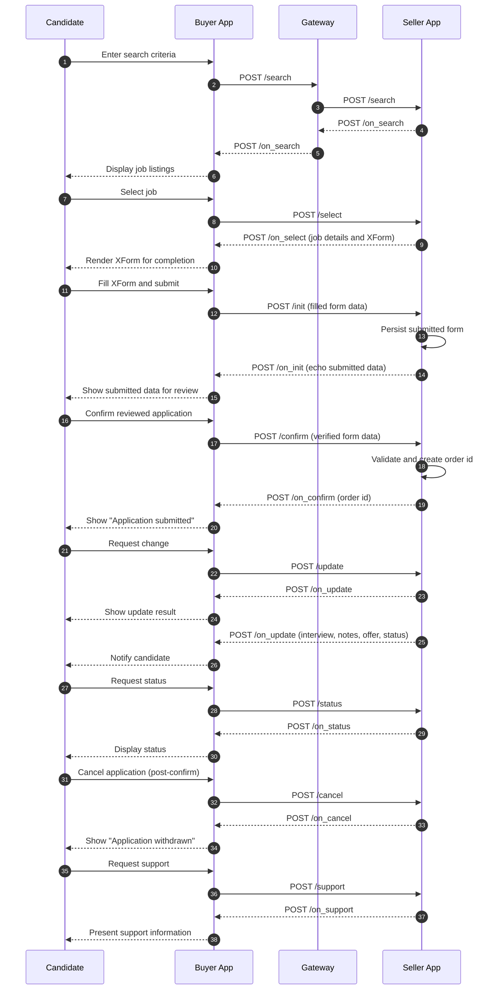

# OPuN Specification

## Overview

OPuN (A Decentralized, Consent-Based Open Network for Persons with Disabilities) establishes a unified protocol enabling structured data exchange for livelihood-related processes. This repository contains the complete API specifications, implementation guides, and example payloads for the OPuN ecosystem.

OPuN facilitates transparent, interoperable, and verifiable communications, ensuring that livelihood opportunities—such as job roles, internships, and project-based assignments—can be discovered, evaluated, and pursued efficiently across decentralized digital infrastructures.

## Repository Structure

```
opun-specification/
├── README.md (this file)
└── livelihood-domain/
    ├── doc/
    │   ├── OPuN_API_Contract_Livelihood_v1.0.0.md
    │   └── OPuN API Contract for Livelihood Domain.pdf
    └── examples/
        ├── README.md
        ├── search/
        ├── select/
        ├── init/
        ├── confirm/
        ├── status/
        ├── update/
        ├── cancel/
        └── support/
```

## Domains

### Livelihood Domain (`opun:livelihood`)

The livelihood domain enables discovery and application for job opportunities, internships, and project-based assignments through a standardized protocol.

**Documentation:**
- [API Contract v1.0.0](./livelihood-domain/doc/OPuN_API_Contract_Livelihood_v1.0.0.md) - Complete API specification with request/response payloads, attribute definitions, and expected behaviors
- [Examples](./livelihood-domain/examples/) - Sample payloads for all API endpoints


**Flow Diagram**


**Key Features:**
- Structured field approach for better clarity and interoperability
- XForms 2.0 XML-based application forms
- Comprehensive application workflow from search to confirmation
- Support for both solicited and unsolicited updates
- Complete lifecycle management (status, cancel, support)

## API Endpoints

The OPuN Livelihood domain includes the following APIs:

### Pre-order APIs
- `/search` - Search for job opportunities
- `/on_search` - Job catalog response
- `/select` - Select a job opportunity
- `/on_select` - Detailed job information and application form
- `/init` - Submit filled application form
- `/on_init` - Form data returned for verification
- `/confirm` - Confirm and submit job application
- `/on_confirm` - Application confirmation response

### Post-order APIs
- `/status` - Check application status
- `/on_status` - Status response
- `/update` - Update application details (solicited)
- `/on_update` - Update response or unsolicited updates (interview schedule, notes, offer, etc.)
- `/cancel` - Cancel application
- `/on_cancel` - Cancellation confirmation
- `/support` - Request support information
- `/on_support` - Support contact details

## Getting Started

### For Developers

1. **Read the API Contract**: Start with the [Livelihood Domain API Contract](./livelihood-domain/doc/OPuN_API_Contract_Livelihood_v1.0.0.md) to understand the complete specification.

2. **Review Examples**: Explore the [example payloads](./livelihood-domain/examples/) to see real-world usage patterns for each API endpoint.

3. **Understand the Flow**: Refer to the Application Flow section in the API Contract to understand the end-to-end process.

### For Platform Integrators

1. **Registry Setup**: Ensure your platform is registered in the OPuN registry with appropriate participant type (BAP or BPP).

2. **Cryptographic Setup**: Generate signing and encryption key pairs (ed25519 for signing, X25519 for encryption) and register public keys.

3. **API Implementation**: Implement all required APIs according to the specification, ensuring compliance with mandatory fields and expected behaviors.

4. **Testing**: Use the example payloads to test your implementation against the specification.

## Key Concepts

### Participant Types

- **Buyer App Platform (BAP)**: Platforms that enable candidates to discover and apply for job opportunities
- **Seller App Platform (BPP)**: Platforms that provide job opportunities and manage applications

### Protocol Principles

- **Decentralized**: Each participant operates its own systems
- **Consent-Based**: All interactions require explicit consent and verification
- **Interoperable**: Standardized APIs ensure seamless communication
- **Verifiable**: Cryptographic signing ensures transaction integrity

### Form Submission Flow

1. BPP provides form structure in XForms 2.0 XML format (no URL)
2. Buyer app renders the form and candidate completes it
3. BAP sends filled form data in `/init`
4. BPP stores and returns form data for review in `/on_init`
5. Candidate reviews and confirms with same form data in `/confirm`
6. BPP verifies and submits application in `/on_confirm`

## Version Information

- **Current API Version**: `1.0.0`
- **Domain**: `opun:livelihood`
- **Document Version**: `1.0.0`
- **Last Updated**: 2024-12-11

## Compliance

All participants are required to ensure full compliance with the API contract specifications on the OPuN network. Non-compliance may result in rejection of requests/responses with appropriate error codes.

## Contributing

When contributing to this specification:

1. Follow the existing documentation structure
2. Ensure all examples are valid JSON
3. Update version history for any changes
4. Maintain consistency with Beckn Protocol core principles
5. Include comprehensive documentation for new features

## References

- [OPuN Protocol Specification](../) - Core protocol documentation
- [Beckn Protocol Core Specification](https://github.com/beckn/protocol-specifications) - Foundation protocol
- [XForms 2.0 Specification](https://www.w3.org/TR/xforms22/) - Form specification
- OPuN Registry Documentation
- OPuN Error Codes Specification

## Support

For questions, issues, or contributions related to the OPuN specification:

- Review the API Contract documentation
- Check example payloads for reference implementations
- Consult the Application Flow section for process understanding
- Refer to error codes specification for troubleshooting

---

**Note**: This specification is actively maintained. Please refer to the version history in individual domain documentation for change tracking.

