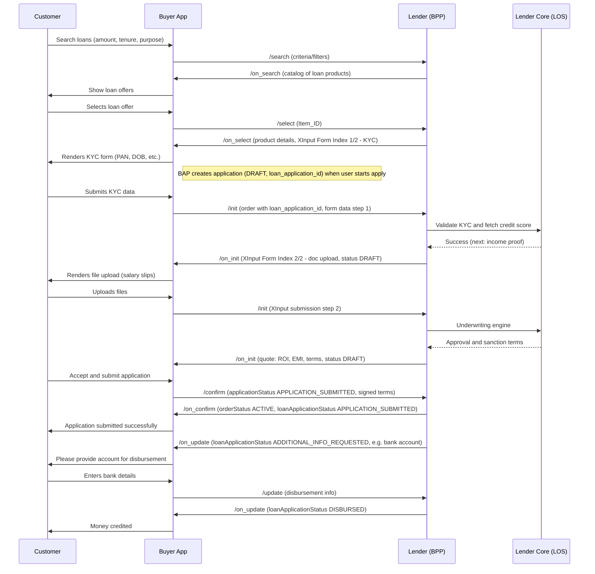
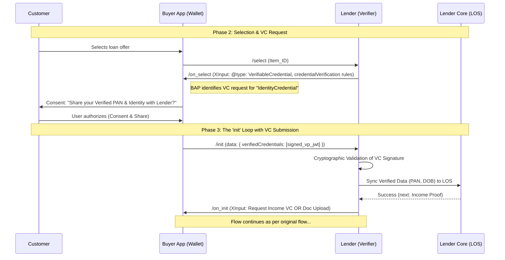

# opun:loan — Complete Journey (Search → Update)

## Protocol alignment

- **Domain:** `opun:loan` (Beckn v2.0 extension).
- **Application:** BAP creates application (DRAFT, `loan_application_id`) before first /init; init sends order; BPP echoes in on_init; confirm sets APPLICATION_SUBMITTED; on_confirm moves BPP from DRAFT to APPLICATION_SUBMITTED.
- **Status values:** Use schema terms (e.g. APPLICATION_SUBMITTED, ADDITIONAL_INFO_REQUESTED, DISBURSED). Multi-step init (XInput form index) is optional; minimum flow is one init → on_init (echo) → confirm → on_confirm.

---

